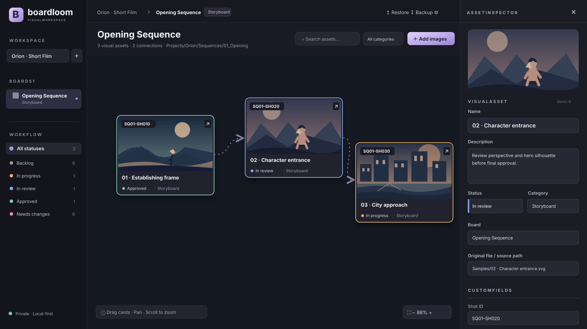

# فریم‌فلو | Boardloom



*پیش‌نمایش رابط کاربری با تصاویر نمونهٔ همراه پروژه.*

**فضای مدیریت تولید و کنترل پروژه با محوریت تصویر.**

فریم‌فلو ایدهٔ بورد آزاد تصویری شبیه PureRef را با کنترل وضعیت تسک‌ها و ارتباط بین شات‌ها ترکیب می‌کند. برای انیمیشن، فیلم، استوری‌بورد، کانسپت‌آرت و تولید تصویر با هوش مصنوعی طراحی شده است.

## قابلیت‌های جدید نسخهٔ ۰.۲

در این نسخه می‌توان قبل از آماده شدن تصویر، برای هر شات تسک ساخت و بین دو نمایش **بورد تصویری (Canvas)** و **جدول کنترل پروژه (Table)** جابه‌جا شد؛ هر دو به یک مجموعه اطلاعات متصل هستند.

- **ویرایش گروهی:** با Ctrl/Cmd و کلیک روی تصاویر، یا Ctrl/Cmd+A، چند آیتم را انتخاب و وضعیت، دسته‌بندی یا بورد مقصد را یک‌جا تغییر دهید.
- **تسک بدون تصویر:** دکمهٔ `+ Task` برای شات‌ها و خروجی‌های برنامه‌ریزی‌شده.
- **بازگشت تغییرات:** Undo/Redo تا ۳۵ تغییر در همان نشست مرورگر؛ پس از بارگذاری مجدد مرورگر تاریخچه پاک می‌شود.
- **جدول تولید:** مشاهدهٔ سریع نام تسک، وضعیت، مسئول و تاریخ تحویل و تغییر وضعیت مستقیماً از جدول.
- **گزارش CSV:** خروجی اطلاعات هر بورد، شامل فیلدهای سفارشی، برای گزارش‌گیری.
- **پیشرفت رنگی و جست‌وجو:** نمایش توزیع وضعیت‌ها و جست‌وجو در مقادیر فیلدهای سفارشی.

**سازگاری:** فایل‌ها و پروژه‌های قبلی بدون مهاجرت داده باز می‌شوند. هنگام حذف آیتم، دادهٔ تصویر بلافاصله از حافظهٔ محلی پاک نمی‌شود تا Undo ممکن باشد. پاک‌سازی کامل فضای ذخیره‌سازی هنوز از کارهای نسخه‌های بعدی است.

## امکاناتی که در نسخهٔ ۰.۱ پیاده‌سازی شده

- افزودن تصاویر با درگ‌ودراپ یا انتخاب فایل و چیدمان آزاد روی بورد؛ زوم و جابه‌جایی محیط.
- کادر رنگی دور تصویر براساس وضعیت تسک؛ امکان افزودن، حذف، تغییر نام و انتخاب رنگ هر وضعیت.
- ساخت چند پروژه و چند بورد با دسته‌بندی دلخواه.
- پنل جزئیات هر تصویر با کلیک: عنوان، توضیح، وضعیت، دسته، برچسب‌ها و مسیر فایل.
- ساخت فیلدهای سفارشی متنی، عددی، تاریخ و نشانی وب؛ تغییر و حذف فیلدها.
- اتصال دو تصویر با فلش جهت‌دار برای نمایش ارتباط و وابستگی.
- ثبت مسیر متنیِ بورد و فایل‌های تصویر، فیلتر وضعیت/دسته‌بندی و جست‌وجو.
- ذخیرهٔ محلی تصاویر و اطلاعات در مرورگر و تهیهٔ فایل پشتیبان JSON شامل تصاویر.

## اجرا

به Node.js نسخهٔ ۲۰ یا جدیدتر نیاز است. کتابخانه‌ای لازم نیست نصب کنید.

```bash
npm run dev
```

آدرس `http://localhost:4173` را در مرورگر باز کنید. برای تست: `npm run check`.

**محدودیت مهم:** مسیر پوشه‌ها فعلاً «متادیتا» هستند؛ مرورگر به‌صورت خودکار به پوشه‌های سیستم‌عامل دسترسی ندارد. سینک تیمی، پایش خودکار پوشه‌ها، اپ دسکتاپ و سیستم هوش مصنوعی به نسخه‌های بعدی مربوط‌اند. پیش از پاک کردن داده‌های مرورگر، از بخش Backup خروجی بگیرید.

اسناد اصلی پروژه انگلیسی نوشته شده‌اند؛ برای ادامهٔ توسعه به `AGENTS.md` و `docs/AGENT_HANDOFF.md` مراجعه کنید.
