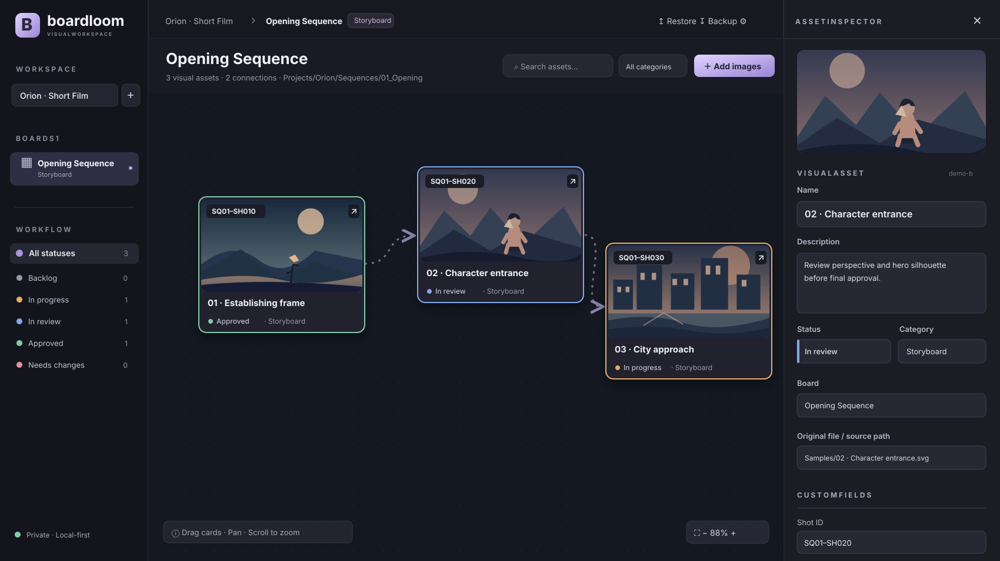

# Boardloom



*Product UI preview using the included sample storyboard assets.*

**Visual project management for image-first production.**

Boardloom combines the spatial freedom of a reference board (in the spirit of PureRef) with the structured workflow of a production tracker and the visual connections of a node canvas. It is designed for film, animation, motion design, concept art, creative agencies, AI-assisted production, and any team that manages work through images.

> Status: **v0.1 local-first working prototype**. This repository includes a running browser application, automated domain tests, and detailed instructions for future engineering agents. It is not yet a hosted service, collaborative product, or native desktop app.

## Features implemented in v0.1

| Feature | Description |
| --- | --- |
| Infinite-style spatial board | Pan, zoom, fit-to-content and freely drag image cards on a large canvas |
| Image import | Add PNG / JPG / WEBP / GIF / AVIF files by picker or drag-and-drop |
| Colored workflow borders | Each image has a visible border reflecting its status |
| Custom workflows | Create, rename, recolor or remove statuses per project; safe reassignment on deletion |
| Projects + boards | Multiple projects and categorized boards with independent layouts |
| Image detail inspector | Click a card to view/edit title, description, status, category, tags and source path |
| Custom metadata schema | Add, rename, remove and choose text/number/date/URL fields per project |
| Directional arrows | Click the link icon on one card then another to make an image dependency |
| Filtering and search | Filter by status/category and search asset names, notes, paths and tags |
| Path metadata | Save textual paths for boards and individual assets |
| Local-first persistence | Workspace metadata in localStorage; image blobs in IndexedDB |
| Portable full backup | Export and restore JSON including all locally imported image contents |
| Zero runtime dependencies | Works with a recent Node.js install; no CDN or external API required |

## Quick start

Requires **Node.js 20+**. No `npm install` is necessary.

```bash
cd boardloom
npm run dev
```

When the repository is published, it can also be cloned from `https://github.com/iAlirezaaa/boardloom`.

Open **http://localhost:4173**. Alternatively, run the downloaded project without cloning if it has not yet been published to GitHub.

Verify the domain logic:

```bash
npm run check
```

### Using the board

1. Start from the sample project and demo board, or create your own project and boards in the sidebar.
2. Drop supported images onto the canvas or select **Add images**.
3. Drag an image to position it; drag empty space to pan; scroll to zoom; click **Fit** to frame content.
4. Click an image to open its metadata inspector and set its status. The image border immediately inherits the workflow color.
5. Use **Settings** to customize status names, colors and metadata fields; use the board's `···` control to define its category and path.
6. Click a card's **chain** control, then another card, to create a directional dependency arrow.
7. Click **Backup** regularly; use **Restore** to import the JSON including images on another installation.

## Architecture

```
index.html                 Browser entry point
server.mjs                 Minimal dependency-free local HTTP server, CSP and MIME handling
src/
  app.mjs                  Canvas rendering, controls, inspector, status/configuration editor
  core.mjs                 Pure domain model and guarded data mutations
  storage.mjs              IndexedDB image storage and portable backup/restore
  styles.css               Desktop-first dark UI
public/
  favicon.svg              Brand mark
  samples/                 Locally authored demo illustrations
tests/                     Native Node domain and render-smoke tests
.github/workflows/ci.yml  CI checks
AGENTS.md                  Top-level instructions for coding agents
docs/                     Vision, implementation architecture, decisions, roadmap, handoff
README.fa.md               Persian overview
```

Storage is **local to the browser and origin**. Metadata persists through `localStorage`; originals are stored as `Blob`s in IndexedDB (no image data is encoded into routine state writes). All stored form strings are escaped when rendered. External URL ingestion, remote telemetry, user accounts and background uploads are deliberately absent.

**Important limitations:** Browsers cannot read or sync arbitrary user-selected filesystem directories merely from a path string. `sourcePath` and `storagePath` are metadata in v0.1; desktop folder watches, thumbnails, file tracking and write-back require explicit OS-scoped permissions in a future Tauri/desktop edition. Browser cache clearing can delete local data: export a backup before deleting browser storage. Large JSON backups can consume memory; a streamed archive format is planned. This release has no multi-user synchronization, ACLs, activity audit log, collaborative conflict resolution, native desktop packaging, or AI integration.

## Product direction

The goal is a **visual production operating system**: an image may represent a reference, shot, asset, task, storyboard panel or generated iteration. Every visual object has an extensible field schema, custom workflow status, history and connections to other items. Boards organize spatial thinking; tables, pipelines and timelines will provide alternate views of the same underlying data. See [Product Vision](docs/PRODUCT_VISION.md) and [Roadmap](docs/ROADMAP.md).

### Inspiration and licensing

- [PureRef](https://www.pureref.com/) — spatial image-reference workflow inspiration only; **no PureRef code/assets copied**.
- [React Flow / xyflow](https://github.com/xyflow/xyflow) — MIT-licensed node-canvas technology evaluated for a future modular canvas engine. v0.1 currently uses a zero-dependency DOM + SVG canvas for local reproducibility; it **does not bundle or clone React Flow**.
- [tldraw](https://github.com/tldraw/tldraw) — architecture inspiration only. Its SDK has its own production licensing requirements; **no tldraw code is bundled**.

The authored Boardloom code and sample illustration assets are offered under [MIT](LICENSE). This doesn't confer rights to third-party brands or externally imported user images.

## Contributing and handoff

Read [AGENTS.md](AGENTS.md) first, followed by [docs/AGENT_HANDOFF.md](docs/AGENT_HANDOFF.md), [docs/PRODUCT_VISION.md](docs/PRODUCT_VISION.md), [docs/ARCHITECTURE.md](docs/ARCHITECTURE.md), and [docs/DECISIONS.md](docs/DECISIONS.md). **Never delete a product requirement without documenting the reason and obtaining product-owner approval for breaking changes.**

## License
MIT.
